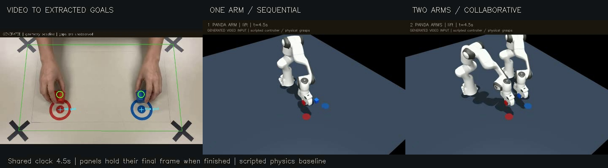

# Two Hands, One or Two Robots

An experiment in transferring the **object goals of a two-hand demonstration** to one or two simulated manipulators.

**Development status:** the first working end-to-end run uses a **Gemini-generated video supplied by the applicant**. Personally recorded phone footage is the next stage and has not yet been evaluated. Generated and real-data results will be reported separately.

[](docs/media/comparison.mp4)

[Watch the comparison](docs/media/comparison.mp4) · [Download the Gemini input](examples/media/gemini_reference.mp4)

The preview shows actual prototype rollouts. The input is generated; the robot controller is scripted and uses simulation state.

## Why we started with a generated video

We first used a short Gemini-generated clip of two hands moving red and blue blocks into matching target rings. It let us test the complete engineering path—perception, table calibration, task representation, resource selection, and physical robot control—before the applicant collected real footage. It also exposed real implementation problems: target rings confused the original tracker, hands obscured objects, and the first two-arm grasp orientation caused hand contact.

The next stage is to record a similar task with real objects, replace the input video, and evaluate whether the same pipeline works. Different objects may require changes to visual detection, simulated geometry, and grasp parameters. We will document those changes and any failures rather than assume the current cube demonstration generalizes.

The generated clip is a development fixture. It is not applicant-collected real-world data and does not satisfy that requirement of the [Humanoid challenge](https://jobs.ashbyhq.com/humanoid/e1a2a9de-ad23-4632-9d93-ee50fd41a221).

## Documentation

- [How the pipeline works](docs/METHOD.md): what comes from the video, how scheduling works, and how the robot moves.
- [Development history and results](docs/DEVELOPMENT.md): tested changes, failures, measurements, and remaining work.
- [Data provenance and real-object transition](docs/DATA_PROVENANCE.md): Gemini versus personal footage, metadata, and object compatibility.
- [Phone recording guide](DATA_COLLECTION.md): the minimum setup for the first real clip.
- [Saved generated-video result](docs/results/generated_baseline.json): portable experiment evidence, including the source hash.

## Research question

When a human performs two tabletop moves at once, should a robot preserve that concurrency or serialize the moves with one arm? We compare one-arm and two-arm execution on the same scenes. The footage currently supplies object identities and start/goal locations. Action dependencies are explicit assumptions or supplied annotations; learning them from a demonstration is future work.

## Working baseline

The pipeline extracts two colored blocks and target rings from an overhead video, maps their locations onto a tabletop using supplied dimensions, chooses a one- or two-arm schedule, and executes **physical grasps** with Menagerie Panda robots in MuJoCo. Blocks are free bodies moved by finger contact; there are no grasp welds or object pose resets.

```text
Video + workspace dimensions
          |
          v
Object starts / target rings / table calibration
          |
          v
Task JSON: move red to red target, blue to blue target
          |
          v
Compare one-arm and two-arm schedules
          |
          v
MuJoCo: reach, close gripper, lift, move, release
          |
          v
Placement checks + contact logs + comparison video
```

This is a **geometric perception and scripted control baseline**. There is no trained VLA/VAM, VLM negotiation, or learned world model yet. Control uses privileged simulator object state. Independent block transfers are an explicit task assumption; dependencies can be supplied in task JSON but are not inferred from human intent.

## Install

Python 3.10 was used for development. No GPU is needed for the controller or perception. Rendering requires an OpenGL/EGL driver; on this Linux workspace, EGL works. `MUJOCO_GL=osmesa` is another option on a machine with OSMesa installed.

```bash
python3 -m venv .venv
source .venv/bin/activate
pip install -r requirements.txt
python3 scripts/fetch_assets.py
```

The asset script fetches the [MuJoCo Menagerie Panda](https://github.com/google-deepmind/mujoco_menagerie/tree/main/franka_emika_panda) at revision `f054586a8e90465d49ee5be15335c4a0c7f57caf`. The robot assets carry their own Apache 2.0 license in `assets/menagerie/franka_emika_panda/LICENSE`.

## Run a phone video

Record using [DATA_COLLECTION.md](DATA_COLLECTION.md), then supply the **measured** workspace size in metres:

```bash
python3 -m src.pipeline data/raw/clip01.mp4 \
  --provenance personal --width 0.50 --height 0.35 --out outputs/clip01
```

For a generated clip, use `--provenance generated`. The labeled development sample is included at `examples/media/gemini_reference.mp4` so the full prototype can be reproduced.

```bash
python3 -m src.pipeline examples/media/gemini_reference.mp4 \
  --provenance generated --width 0.50 --height 0.35 --out outputs/gemini
```

For the generated sample, 50 × 35 cm is an **assumed simulation scale**, not a measurement recovered from the video.

Outputs include `task.json`, a tracking overlay, resource plans, a readable coordination message, both MuJoCo rollout videos, individual result files, and `comparison.mp4`. The comparison uses a common clock and holds each panel's last frame after it finishes. `--no-render` skips MuJoCo rendering and the comparison; it still writes the video tracking overlay.

If automatic corner detection fails, pass `--calibration path/to/calibration.json` containing `{"corners_px": [[x1,y1],[x2,y2],[x3,y3],[x4,y4]], "workspace_m": [0.50,0.35]}`. Corner order is top-left, top-right, bottom-right, bottom-left. Check `extraction.jpg` before trusting the mapping.

## Current development result

On the supplied ten-second Gemini clip, the full pipeline completed both placements with one arm in **19.6 simulated seconds** and two arms in **10.2 simulated seconds**, with no recorded inter-arm or nonbase robot/table contact. Three layouts with ±1 cm start/goal perturbations passed for both arm counts (six additional rollouts). These are deterministic development checks on one source scene, **not a generalization benchmark**.

The timing difference mostly reflects the scripted schedule: two independent moves run in parallel. It is not evidence of learned reasoning. A second arm is selected by comparing schedule time plus an explicit recruitment penalty, with a conservative transport-corridor clearance check. The check is not a complete robot motion planner; actual contact is logged during execution and invalidates overall success.

Per-object success requires target error below 3 cm, a settled height near the tabletop, and an observed lift above 8 cm. The initial two-arm run placed both blocks but touched hands; rotating the grasp orientation removed that contact. Tracking still loses confidence during occlusion, so the task is grounded in clean start frames and visible target rings rather than an invented hand trajectory.

## Checks and separate stages

```bash
python3 -m unittest discover -s tests -v
python3 -m src.extract data/raw/clip01.mp4 --provenance personal --out outputs/clip01
python3 -m src.plan outputs/clip01/task.json
python3 -m src.simulate outputs/clip01/task.json --arms 2 --out outputs/clip01/two_arms
python3 scripts/smoke_physics.py outputs/clip01/task.json outputs/physics_smoke
```

The earlier `src.video` module is a minimal synthetic fixture/legacy color tracker; use `src.extract` for the supplied video and new phone clips.

## Reproduce the controller without the source video

A portable task extracted from the generated clip is included, so the physics stage can also be reproduced without reprocessing the bundled video:

```bash
python3 -m src.plan examples/gemini_extracted_task.json
python3 -m src.simulate examples/gemini_extracted_task.json --arms 1 --out outputs/reproduced/one_arm
python3 -m src.simulate examples/gemini_extracted_task.json --arms 2 --out outputs/reproduced/two_arms
```

This replays the extracted task. The full-pipeline command above reprocesses the bundled generated clip. Before the final submission, an applicant-recorded example and its derived artifacts should be made available so reviewers can reproduce the real-data stage too.

## Repository map

```text
src/extract.py             Video perception, calibration, task JSON, tracking overlay
src/plan.py                Dependencies, corridor clearance, arm-count selection
src/scene.py               MuJoCo scene and Panda model composition
src/simulate.py            IK, actuator control, physical grasps, results, rollout video
src/pipeline.py            End-to-end command and comparison video
scripts/fetch_assets.py    Pinned third-party robot-model download
scripts/smoke_physics.py   Small start/goal perturbation check
tests/test_plan.py         Scheduling decisions and invalid-input checks
examples/                 Portable task inputs and labeled Gemini source video
docs/                     Method, provenance, results, comparison video and preview
data/                     Local videos (not tracked)
outputs/                  Generated runs (not tracked)
```

## Collection

See [DATA_COLLECTION.md](DATA_COLLECTION.md). All challenge demonstrations must be recorded by the applicant. Raw personal footage can be kept private, but a small permitted sample and extracted annotations should be included in the final public submission to make the data provenance and effect auditable.

## Planned evaluation

Next: validate with personally collected footage, evaluate the same held-out layouts with both arm counts, and test a crossing-path scene where the planner chooses to serialize. A replay baseline and a learned predictor remain future work. Adding a learned model should answer a measurable question (for example, predicting completion or whether concurrent moves will interfere), rather than relabeling this controller as a VAM.
